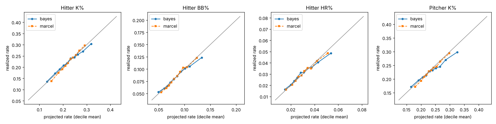

# MLB Player Projections

Hierarchical Bayesian projections of MLB player rates, written in **PyMC** and ported to **Stan**, backtested against a Marcel-style baseline and league average, with an independent **R** replication of the baselines and scoring.

Projected rates, each per plate appearance (hitters) or batter faced (pitchers):

| Stat | Meaning |
|---|---|
| `bat_k` | hitter strikeout rate |
| `bat_bb` | hitter walk rate |
| `bat_hr` | hitter home run rate |
| `pit_k` | pitcher strikeout rate |

Data: the Lahman Baseball Database through the 2025 season, via the [`pylahman`](https://pypi.org/project/pylahman/) package (SABR, CC BY-SA 3.0). Season lines are summed across stints (trades), and age is the player's age on July 1.

## Model

For player *i* in season *s*, on the logit scale:

```
logit p[i,s] = theta[i,s] + b1*(age-27) + b2*(age-27)^2 + season[s]
theta[i,first] ~ Normal(mu, sigma_player)        # partial pooling toward the league
theta[i,s]     = theta[i,s-1] + Normal(0, tau)   # talent drifts year to year
season         ~ zero-sum Normal(0, 0.2)         # run environment
k[i,s]         ~ Binomial(n[i,s], p[i,s])
```

- A player with little history is pulled toward the league mean. A player with a long track record is not.
- The random walk weights recent seasons more heavily without fixed 5/4/3 weights. Missed seasons stay in the walk with no likelihood term.
- To project the next season, theta steps forward once more, the aging curve is applied at the new age, and the last season's environment is reused. The posterior gives a full predictive distribution for each player, not just a point estimate.

Sampling uses NUTS (4 chains × 500 draws after 500 tuning steps). R-hat is recorded for every fit.

- PyMC: [`projections/model.py`](projections/model.py)
- Stan: [`projections/stan/rates.stan`](projections/stan/rates.stan), fit through PyStan in [`projections/stan_model.py`](projections/stan_model.py)

## Baselines

- **League average:** the prior season's league rate.
- **Marcel-style:** the last three seasons weighted 5/4/3, with 1,200 opportunities of league-average performance added for regression. There is no age adjustment.
- **Empirical-Bayes beta-binomial** (R only): a beta prior fitted by maximum likelihood, then each player's posterior mean.

## Backtest design

For each target season (2023, 2024 and 2025), each model is fit only on the three seasons before it. Nothing from the target season enters a fit, and the league rate comes from the prior season. Players are scored if they had at least 100 opportunities across the history window and at least 100 in the target season. That gives 1,144 hitter-seasons and 1,220 pitcher-seasons.

Metrics ([`projections/metrics.py`](projections/metrics.py)):

- per-PA log loss and Brier score, treating each plate appearance as a binary outcome
- PA-weighted RMSE of the rate
- calibration by decile of the projected rate
- coverage of the 50% and 80% posterior predictive intervals for each player's count
- a paired bootstrap over players for the log loss difference between models

## Results

Log loss difference, Bayesian model minus baseline, pooled over 2023-2025. Negative means the Bayesian model is better.

| Stat | vs Marcel | 95% CI | vs league | 95% CI |
|---|---|---|---|---|
| Hitter K% | **-0.00032** | [-0.00052, -0.00010] | -0.00707 | [-0.00816, -0.00609] |
| Hitter BB% | +0.00002 | [-0.00005, +0.00010] | -0.00306 | [-0.00359, -0.00257] |
| Hitter HR% | +0.00009 | [+0.00005, +0.00013] | -0.00154 | [-0.00188, -0.00122] |
| Pitcher K% | +0.00025 | [+0.00008, +0.00042] | -0.00303 | [-0.00367, -0.00243] |

What this shows, plainly:

- The model beats league average on every stat and every season.
- Against Marcel, it is better on **hitter strikeout rate** in all three seasons (RMSE 0.0354 vs 0.0372 in 2023), and the bootstrap interval excludes zero.
- It ties Marcel on walk rate. It is slightly but measurably worse on home run rate and pitcher strikeout rate. The calibration plot points to the cause: the top projected decile realizes below its projection, so the model shrinks extreme pitchers and power hitters too little. Marcel's heavy fixed regression handles those players better. Stat-specific priors on `sigma_player` and `tau` are the next thing to test.
- Interval coverage is close to nominal: 80% intervals cover 75-85% of outcomes, and 50% intervals cover 50-63%.
- R-hat is at most 1.022 on every fit except hitter HR% in 2025 (1.094), which needs longer chains before that fit is trusted.

Full tables: [`results/backtest_summary.csv`](results/backtest_summary.csv), [`results/bootstrap.csv`](results/bootstrap.csv), [`results/backtest_players.csv`](results/backtest_players.csv).



### Stan vs PyMC

[`projections/compare_stan.py`](projections/compare_stan.py) fits both versions on the same hitter K% splits. The point projections correlate at 0.9999, the largest difference for any player is 0.003 in rate, and both versions beat Marcel in every season.

| Season | Stan log loss | PyMC log loss | Marcel log loss | Stan 80% coverage |
|---|---|---|---|---|
| 2023 | 0.52020 | 0.52020 | 0.52058 | 0.81 |
| 2024 | 0.52035 | 0.52036 | 0.52071 | 0.81 |
| 2025 | 0.51710 | 0.51712 | 0.51734 | 0.76 |

Results: [`results/stan_vs_pymc_bat_k.csv`](results/stan_vs_pymc_bat_k.csv).

### R replication

[`r/replicate.R`](r/replicate.R) uses base R only. It re-implements the Marcel-style baseline and the scoring metrics, and adds an empirical-Bayes beta-binomial model, on the same splits ([`results/r_input/`](results/r_input)). The R Marcel projections match the Python ones exactly on all 12 stat-season splits (the script stops if any differs by more than 1e-9). The empirical-Bayes model lands close to Marcel: 0.52040 vs 0.52058 log loss on 2023 hitter K%, for example. Results: [`results/r_replication.csv`](results/r_replication.csv).

## Run it

```bash
pip install -e ".[dev]"
pytest -q                                   # 15 tests, one fits a small synthetic model
python -m projections.backtest              # PyMC backtest, all stats, 2023-2025 (~30-40 min on 4 cores)
python -m projections.figures               # calibration plot + skill table
python -m projections.compare_stan          # Stan vs PyMC on hitter K% (needs pystan, Linux/macOS)
python -m projections.export_for_r && Rscript r/replicate.R
```

## Limits

- Lahman has season totals only: no minor league, pitch-level or batted-ball data. Rookies with no MLB history are not projected.
- Rates only. There is no playing-time model and no conversion to runs or wins.
- The aging curve is a single quadratic shared by all players for each stat.
